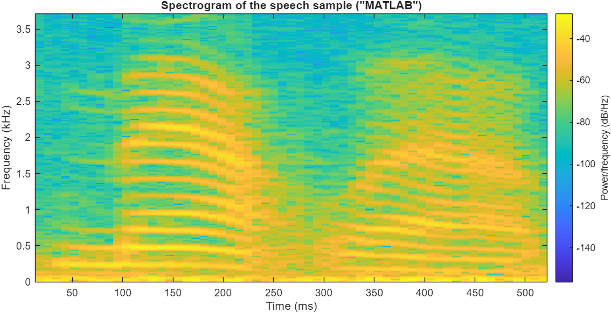
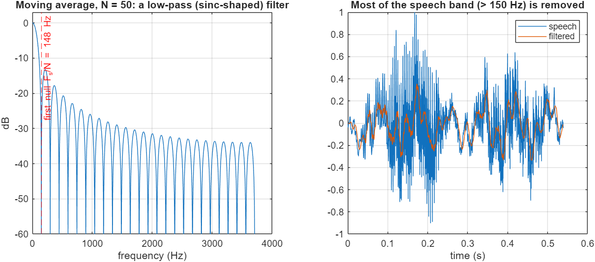
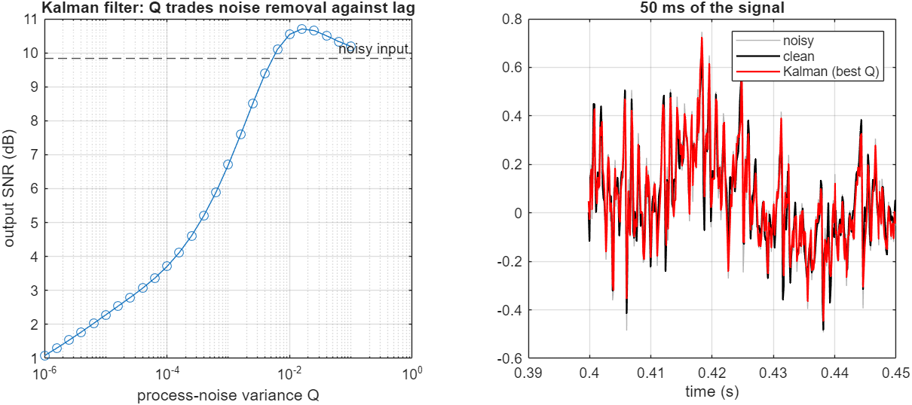

# Signals & Systems in MATLAB, Homework 4: Speech Spectrogram, Moving Average and Kalman Denoising

> **Course:** Signals and Systems, Amirkabir University of Technology. Run `main` in MATLAB (Signal Processing and Communications toolboxes); figures go to `results/`.
>
> The assignment recorded 10 s of the student's voice from the microphone. To keep the script reproducible, it uses MATLAB's built-in speech sample (`load mtlb`, the word "MATLAB", F_s = 7418 Hz). Set `RECORD = true` to record your own voice instead.

## A. Spectrogram
The short-time Fourier transform (256-sample Hamming window, 75 % overlap) shows:
- **Voiced sounds** as harmonic stacks (pitch and formants).
- **Fricatives** as broadband noise.

## B. Moving-average filter, N = 50
$y[n]=\frac1N\sum_{k=0}^{N-1}x[n-k]$ is a low-pass filter with a sinc-shaped response. Its first null is at F_s/N = 148 Hz, so on speech it removes almost everything above the fundamental. It is a smoother, not a speech-preserving filter.

## C. AWGN at 10 dB and a scalar Kalman filter
**The model:** a random walk, $x_k = x_{k-1} + w_k$ with variance Q, observed as $z_k = x_k + v_k$ with variance R.

| Filter | Output SNR |
|---|---:|
| Noisy input | 9.8 dB |
| Kalman, original tuning (Q = 10⁻⁵, R = 0.01) | **1.9 dB** (worse than doing nothing) |
| Kalman, best Q from a sweep (R = measured noise variance) | 10.7 dB |
| Moving average, N = 50 | 1.7 dB |

**Discussion:**
- **Original tuning.** It assumed the signal changes very slowly (small Q/R), so the filter lags behind the speech waveform and smooths it away. The SNR therefore dropped by 8 dB.
- **Best case.** Sweeping Q shows that a first-order random-walk model can gain only about 1 dB on wideband speech. Speech is not a slowly varying signal at the sample level.
- **What would work better.** A higher-order (AR/LPC) state model, or spectral subtraction or Wiener filtering in the STFT domain.

## Changes compared with the original submission
- **Reproducibility.** The microphone recording was replaced by a bundled speech sample, with recording kept as an option.
- **Quantitative evaluation.** The original only plotted the filtered signals. The new version measures SNR, sweeps the Kalman tuning, and plots the moving-average frequency response that explains the result.

**Sepehr Ebrahimi**, B.Sc. Electrical Engineering, Amirkabir University of Technology (2026)
